<p align="center">
  
</p>

<h1 align="center">Origami</h1>

<p align="center">
  <b>Do texto ao episódio publicado.</b><br>
  Um estúdio local que transforma um conto ou um livro em uma série narrada: texto revisado, vozes por personagem,
  trilha original, vídeos verticais e horizontais com legenda, capas e capítulo pronto para leitura.
</p>

<p align="center">
  
  
  
  
  
</p>

<p align="center">
  <a href="https://origami.sunnar.com.br/"><b>▶ Ver a demonstração online</b></a>
  &nbsp;·&nbsp; abre no navegador, sem instalar nada, com um tour guiado pelas telas
</p>

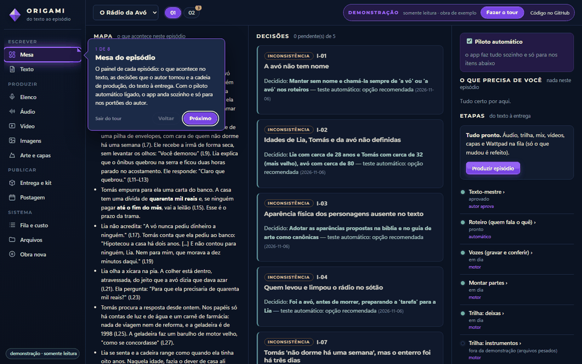

> A demonstração usa uma obra de exemplo de verdade, produzida pelo próprio pipeline: texto, roteiro, vozes, trilha,
> imagens triadas, capas e os dois vídeos da Parte 1 e 2. Ela é somente leitura: os botões de ação mostram um aviso
> em vez de rodar.

---

## O que ele faz

O autor entrega um texto. O Origami faz o resto e **para apenas onde a decisão é humana**:

```
texto bruto → leitura e bíblia da obra → texto-mestre do episódio → roteiro de áudio (quem fala o quê)
           → vozes por personagem → trilha composta por parte → mixagem → legenda palavra a palavra
           → vídeos 9:16 (partes) e 16:9 (episódio) → capas e miniatura → capítulo para leitura → kit de postagem
```

Tudo roda no computador do autor, com uma GPU de 6 GB: síntese de voz, transcrição, geração de imagem e
renderização de vídeo dividem a placa por meio de uma fila única. A IA de texto (Claude) é usada como um
"trabalhador sem memória": cada tarefa é uma chamada isolada, com contexto mínimo e saída validada por JSON Schema.

## Destaques técnicos

| | |
|---|---|
| **Piloto automático com portões humanos** | Com a fila parada, o motor põe na fila o próximo passo de cada episódio. Ele nunca passa por um portão do autor (aprovar o texto, escolher as vozes, ouvir e aprovar o áudio). Um erro só segura o que depende dele e vira uma pendência na tela "O que precisa de você". |
| **Cadeia incremental por assinatura** | Cada etapa declara as entradas (sha1 dos arquivos, valores e o sha1 do próprio script). Mudar uma fala refaz só a parte daquela fala. Mudar só o código **não** refaz um episódio pronto: a interface mostra "código novo disponível" e o autor decide. |
| **Um dono da GPU** | O worker é o único processo que usa a placa. Antes de cada etapa, ele libera os outros donos de VRAM (servidor de voz, ComfyUI) e liga sob demanda o serviço que vai usar. Um lock de arquivo do Windows garante um worker só, mesmo depois de uma queda. |
| **Triagem de imagens em duas fases** | Primeiro, filtros sem IA e sem custo (faixa preta do VAE, imagem lisa ou estourada, topo claro onde entra o título). Depois, um modelo de visão confere contagem de objetos, fidelidade ao trecho, ficha das personagens e composição. As 3 melhores ficam marcadas. Se nenhuma passa, o pedido de imagem é reescrito e sai outra rodada. |
| **Consistência visual da série** | Guia de arte por obra (estilo, regras de capa, fichas fixas das personagens por contexto), imagens de referência por personagem e biblioteca de cenários reaproveitados entre episódios. |
| **Robustez do worker** | Job que derruba o motor volta para a fila com contador de tentativas. Limite de uso da IA adia só os jobs de texto até o horário de volta. Comandos têm teto de tempo. O cancelamento derruba a árvore inteira de processos. |
| **Áudio aprovado antes do vídeo** | Legenda, vídeos e entrega só entram na fila depois que o autor ouve e aprova a mixagem. Assim, um erro de áudio não custa uma hora de renderização. |
| **Trilha composta por código** | Harmonia a 4 vozes com condução por movimento mínimo (sem quintas e oitavas paralelas), duração exata por parte e stems renderizados com instrumentos SFZ. |

## Telas

| Mesa do episódio | Texto-mestre e revisão |
|---|---|
| 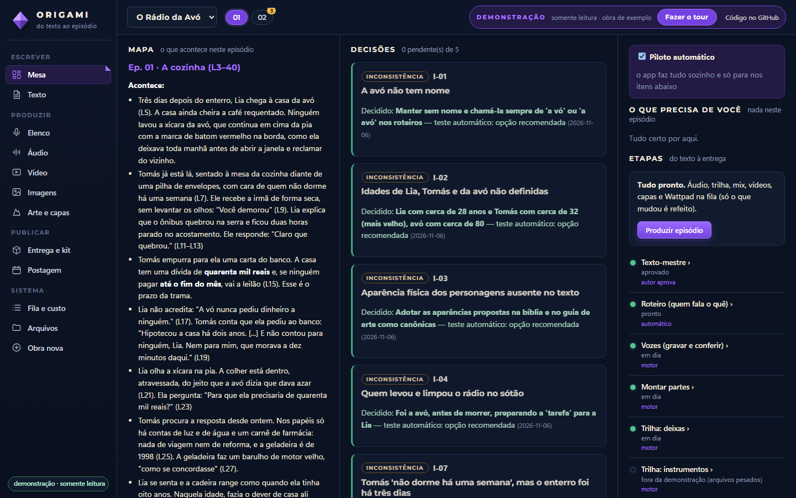 | 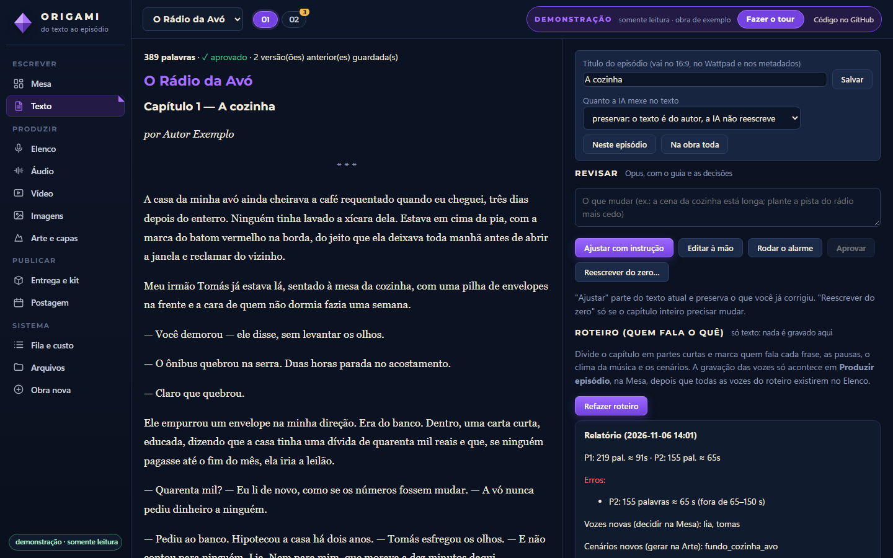 |
| **Áudio: falas conferidas e mixagem** | **Vídeo e checagens automáticas** |
| 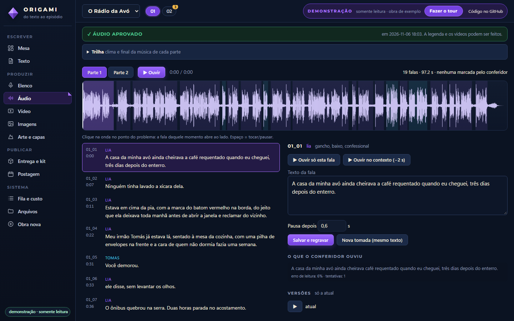 | 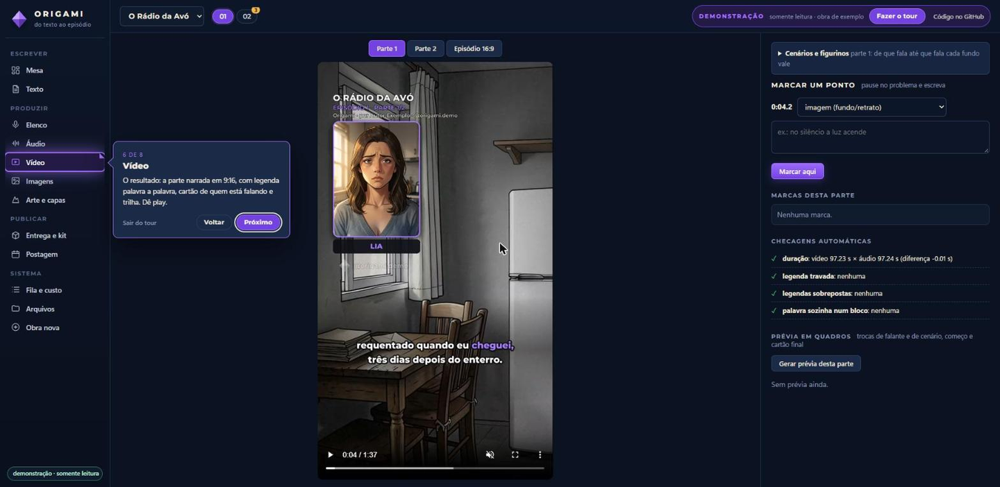 |
| **Imagens e triagem** | **Arte, capas e grade do perfil** |
| 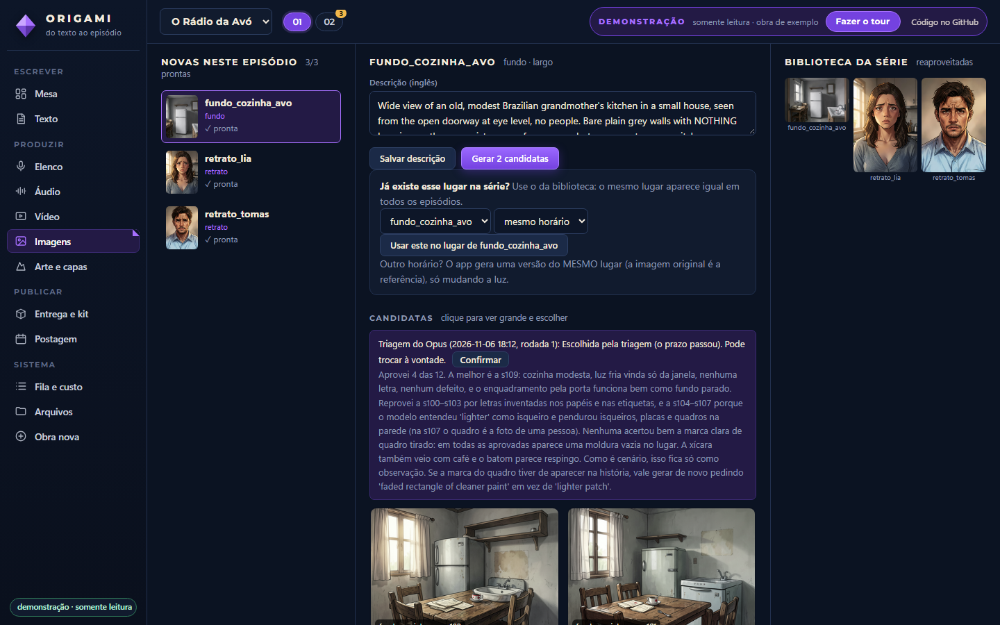 | 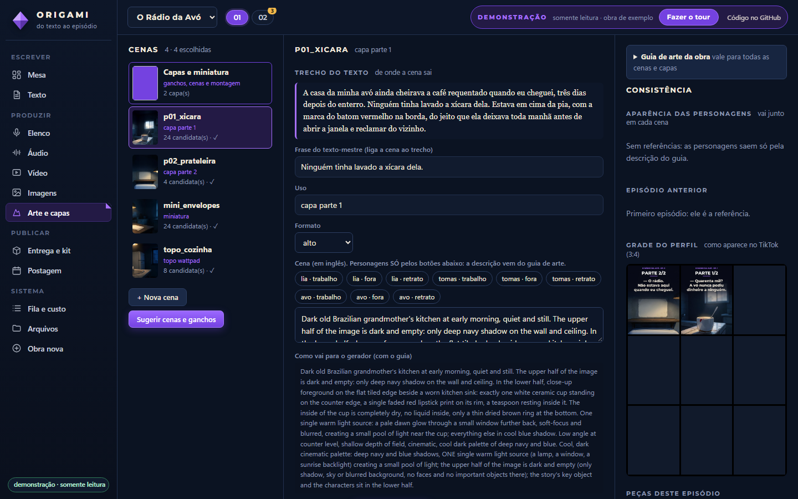 |
| **Kit de postagem e entrega** | **Fila do motor e custo por tarefa** |
| 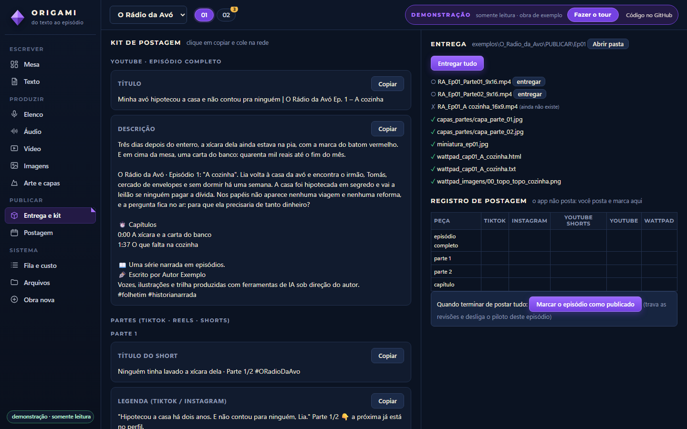 | 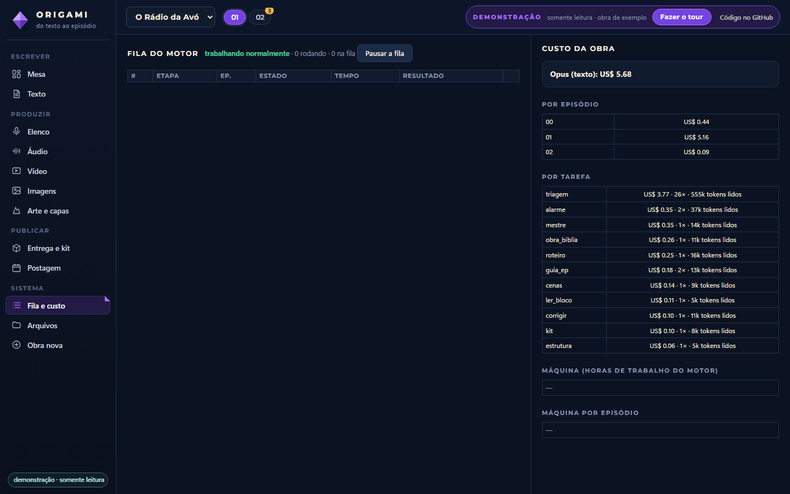 |

Capas geradas pelo próprio pipeline para a obra de exemplo:

<p align="center">
&nbsp;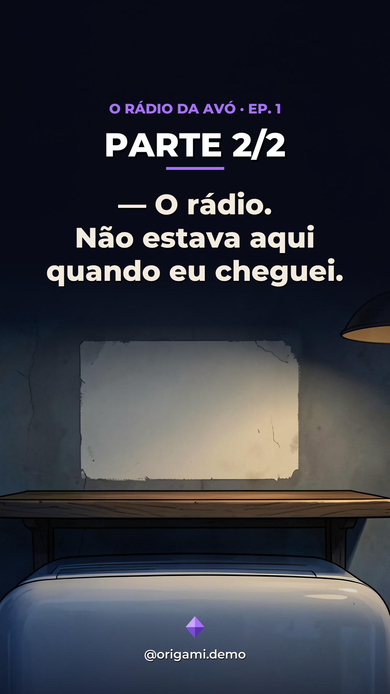</p>

## Arquitetura

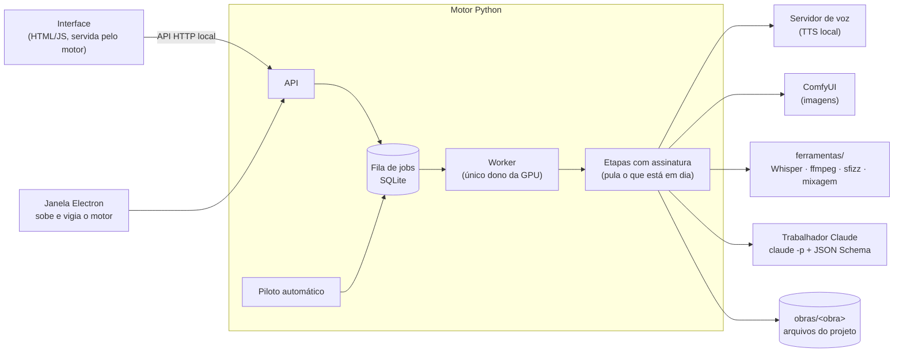

Mais detalhes em [`docs/arquitetura.md`](docs/arquitetura.md).

## Estrutura

```
app/            janela Electron: sobe o motor, religa se ele cair
motor/          servidor Python: fila, API, etapas, piloto, triagem, revisão, publicação
interface/      telas (HTML/JS/CSS sem framework), servidas pelo motor
trabalhador/    tarefas da IA de texto: um prompt .md + um .schema.json por tarefa
ferramentas/    scripts de voz, música e vídeo chamados pelas etapas
recursos/       marca padrão, modelos de obra nova, pronúncia global
exemplos/       obra de demonstração (texto, roteiro, vozes, mixagem, imagens, capas e vídeos)
demo/           a demonstração online: site estático gerado por ferramentas/demo/exportar_site.py
testes/         pytest com banco e obras temporários
```

## Rodar no seu computador

A demonstração local abre a mesma interface sobre a obra de exemplo, **sem GPU, sem modelos e sem IA**, em modo
somente leitura. Só precisa do [Python 3.10+](https://www.python.org/downloads/).

- **Windows:** clique duas vezes em `abrir_demo.bat`.
- **Linux/macOS:** `./abrir_demo.sh`

Na primeira vez, o atalho cria um ambiente em `.venv` e instala o mínimo (`requirements-demo.txt`, 1 a 2 minutos).
Depois disso, abre o navegador sozinho numa porta livre, e o tour começa.

Para desenvolver e rodar os testes:

```bash
python -m venv .venv
.venv\Scripts\activate            # Linux/macOS: source .venv/bin/activate
pip install -r requirements.txt
python -m pytest testes -q
```

## Como a demonstração online funciona

`ferramentas/demo/exportar_site.py` sobe o motor em modo demonstração, percorre todas as leituras que as telas fazem
e grava cada resposta em `demo/dados/`, com caminhos relativos. Também copia as imagens, os vídeos e o áudio citados.
No navegador, um **service worker** (`demo/sw.js`) responde no lugar do motor:
- `/api/…` e `/estado` saem das respostas gravadas;
- `/arquivo?c=…` sai dos arquivos estáticos, com suporte a Range para o vídeo poder pular;
- qualquer ação recebe o aviso da demonstração.

Assim, a interface roda sem nenhuma mudança. A pasta `demo/` é publicada no Cloudflare Pages, sem passo de build
(saída: `demo`), com cabeçalhos de segurança próprios em `demo/_headers`.

## Pipeline completo

A produção de verdade precisa dos serviços locais que ficam fora deste repositório:

- **Windows** com GPU NVIDIA (testado com 6 GB) e `ffmpeg` com NVENC em `ffmpeg/`;
- **servidor de voz** (TTS com voz por descrição) e **ComfyUI** com os modelos de imagem, nas portas de `config.json`;
- **Whisper** para alinhar a legenda palavra a palavra;
- **sfizz** e instrumentos SFZ para a trilha, e um mixador por linha de comando;
- **Claude Code** (`claude -p`) autenticado, para as tarefas de texto e a triagem de imagens.

Copie `config.exemplo.json` para `config.json` e ajuste os caminhos e as portas.

## Licença

Código disponível apenas para leitura e avaliação. Todos os direitos reservados. Veja [LICENSE](LICENSE).
